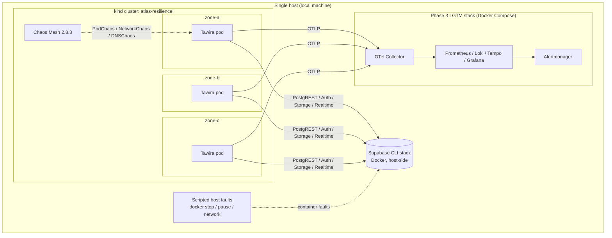

# Atlas Resilience

> Resilience engineering for the Atlas platform: failure injection, Game
> Days, and measured recovery against a real application, run locally at
> zero cost.

## Problem Statement

Systems are usually shown running and rarely shown failing. "Highly
available" is an assertion until someone kills a zone, partitions the
database, or expires a certificate and measures what happens. Atlas
Resilience does that deliberately. Scenarios declare hypotheses and targets
before injection. Completed runs
preserve client outcomes, database reconciliation and Phase 3 telemetry,
including failed hypotheses. The status table distinguishes measured runs
from designs that have not been exercised.

## A note on anonymization

The workload under test is Tawira, a production SaaS application I run,
not a sample app. Service names and other identifying details are
genericized (`atlas-demo-*`) because Tawira is private. Behavior,
timings, and defects reported here are real and unmodified. Everything
runs against a local Supabase instance, never against production data.
See [ADR-0003](docs/adr/ADR-0003-target-workload.md) for why a real
application was chosen, consistent with the same decision in
[`atlas-security`](https://github.com/spacecode-art/atlas-security) and
[`atlas-observability`](https://github.com/spacecode-art/atlas-observability).

## Overview

Atlas Resilience is Phase 5 of the Atlas platform. It runs Tawira on a
three-zone kind cluster, injects failures with Chaos Mesh and scripted
host-side faults, watches the results through the Phase 3 Golden Signals
stack, and produces runbooks, measured RTO/RPO, and blameless
postmortems. Defects found along the way are fixed with before/after
evidence.

---

## Objectives

- Seven failure scenarios (SC-01 to SC-07), each a vertical slice:
  design doc, chaos experiment, runbook, measured RTO/RPO, postmortem,
  all sharing one ID
- A real application on a three-zone local cluster, with replicas
  spread across zones
- Every experiment states its hypothesis, steady state, blast radius,
  and abort condition before it runs
- Detection time measured through the Phase 3 Golden Signals stack, not
  assumed
- Defects found by experiments fixed in the application with
  before/after evidence
- Every non-trivial decision recorded as an ADR, same discipline as the
  other Atlas repositories

---

## Phase 5 progress

The [roadmap checklist](docs/phase-5-status.md) maps each required deliverable
to its evidence and remaining work. SC-01 has one measured local run. SC-02 is
fixture-tested with an explicit runner; its live fault, DNS/certificate
designs and the recorded Game Day remain open. Designs, fixture tests and live observations have separate status.

## Failure Scenarios

| ID | Scenario | Method | Status |
|---|---|---|---|
| SC-01 | AZ failure | Stop or partition a zone-labeled kind worker; Tawira spread across zones | Measured once: 60 s RTO, `sc01c3` ([results](docs/scenarios/SC-01-zone-loss.md)) |
| SC-02 | Database failure | Local host database stop/restore first; egress fault as a separate comparison | [Prepared, not run](docs/scenarios/SC-02-database-failure.md) |
| SC-03 | DNS failure | Chaos Mesh DNSChaos against the load pod's Tawira Service lookup | Design prepared; not run |
| SC-04 | Certificate expiration | Disposable local TLS boundary with an expired X.509 certificate | Boundary design required; not run |
| SC-05 | IAM compromise | Tabletop and isolated MiniStack rehearsal | [Designed, not rehearsed](docs/scenarios/SC-05-iam-compromise.md) |
| SC-06 | Secrets leak | Tabletop, synthetic-secret detection and rotation drill | [Designed, not rehearsed](docs/scenarios/SC-06-secrets-leak.md) |
| SC-07 | Third-party dependency failure (email, payments) | NetworkChaos on egress to each provider | Planned |

Not every scenario maps to a chaos tool, and this repo says so rather
than pretending otherwise. SC-05 and SC-06 are tabletop exercises. Zones
are node labels on one machine, not independent fault domains, so loss
of the database's own zone cannot be simulated (see
[ADR-0001](docs/adr/ADR-0001-local-kind-cluster-as-failure-domain.md)).

---

## Architecture Diagram



---

## Repository Structure

```text
atlas-resilience/
├── .github/
│   ├── workflows/
│   │   └── ci.yml                 # secrets scan via atlas-security
│   └── dependabot.yml
├── cluster/
│   └── kind-config.yaml           # 1 control plane + 3 zone-labeled workers
├── target/
│   └── tawira/
│       ├── tawira.yaml            # Deployment (3 replicas, zone spread) + Service
│       └── .env.example
├── chaos/                         # Chaos Mesh 2.8.3 install values + smoke experiment
├── load/                          # open-loop sale generator + result validator
├── measurements/                  # windows.mjs analyzer + per-run results
├── scripts/                       # SC-01/SC-02 runners and pod-CIDR check
├── terraform/                     # (not yet built) AWS reference design, plan-only
├── docs/
│   ├── adr/                       # Architecture Decision Records
│   ├── evidence/
│   │   ├── spike/                 # environment spike evidence (S1 to S5)
│   │   └── replica-identity/      # before/after for per-replica metric series
│   ├── scenarios/                 # SC-01 results; SC-02/SC-05/SC-06 prepared
│   ├── runbooks/                  # SC-01 and SC-02 operator procedures
│   ├── gameday/                   # plan and recording template; not yet executed
│   ├── postmortems/               # SC-01 blameless postmortem
│   ├── findings/                  # detection gap and remediation acceptance criteria
│   ├── threat-model.md            # (not yet written)
│   ├── cost-model.md              # (not yet written)
│   └── slo-rto-rpo.md             # v0.1 targets and measured SC-01 result
├── .editorconfig
├── .gitignore
├── CHANGELOG.md
├── CONTRIBUTING.md
├── LICENSE
└── README.md
```

---

## Technology Choices

| Choice | Why this, not the alternative |
|---|---|
| **kind (3 zone-labeled workers)** over live EKS | Chaos experiments are repeated and iterated on; burst-deploying cloud infrastructure for each one costs money and time. The Kubernetes API surface exercised is the same. See [ADR-0001](docs/adr/ADR-0001-local-kind-cluster-as-failure-domain.md). |
| **Chaos Mesh plus scripted host faults** over a single tool | Chaos Mesh gives declarative, reviewable CRDs for in-cluster faults but cannot reach host-side containers. Scripts cover only what it cannot, and each states why. See [ADR-0002](docs/adr/ADR-0002-chaos-tooling.md). |
| **Tawira (real app)** over a purpose-built sample | A real application produces real findings. A fallback to a minimal app is defined in ADR-0003 if the environment spike fails. |
| **Supabase CLI stack on the host** over Supabase manifests on kind | Tawira uses Postgres/PostgREST, Auth, Storage, and Realtime. Reproducing four services on kind adds plumbing without improving the resilience evidence. |
| **Phase 3 LGTM stack** over a new observability setup | Detection time should be measured with the stack already built, which also exercises it against a containerized workload. |
| **Locally built, unsigned image** over the signed CI image | The CI image bakes in a browser-facing Supabase URL that cannot point at a local backend. The local image sits outside the Phase 2 signing chain, and this is stated, not hidden. |

---

## Deployment Guide

**Prerequisites:** Docker, `kind`, `kubectl`, Node (for `npx supabase`),
a Tawira checkout, and the `atlas-observability` stack running. Scripted
bring-up (`up.sh`) is deliberately deferred until the manual flow is
proven by the spike.

```bash
# 1. Supabase (in the Tawira checkout). Note the publishable and secret keys.
npx supabase start
npx supabase migration up --local   # a restored local DB can lag the code
npx supabase status

# 2. Cluster (in this repo)
kind create cluster --config cluster/kind-config.yaml
kubectl get nodes -L topology.kubernetes.io/zone
docker network inspect kind -f '{{range .IPAM.Config}}{{.Gateway}} {{end}}'
# The IPv4 value is <GATEWAY>: the host as the pods see it.

# 3. Image (in the Tawira checkout). VITE_* is read by the BROWSER, so 127.0.0.1.
export SB_PUB='<publishable key>'
docker build -t tawira:chaos-local \
  --build-arg VITE_SUPABASE_URL=http://127.0.0.1:54321 \
  --build-arg VITE_SUPABASE_PUBLISHABLE_KEY="$SB_PUB" \
  --build-arg VITE_SITE_URL=http://127.0.0.1:3000 .
kind load docker-image tawira:chaos-local --name atlas-resilience

# 4. Deploy (in this repo)
cp target/tawira/.env.example target/tawira/.env   # fill in <GATEWAY> and keys
kubectl apply -f target/tawira/tawira.yaml
kubectl -n tawira create secret generic tawira-env --from-env-file=target/tawira/.env
kubectl -n tawira rollout restart deploy/tawira
kubectl -n tawira get pods -o wide
```

The first `apply` creates pods before the secret exists, so they error
until the `rollout restart` picks it up. Expected, not a fault.

**Known limitation: the test bed has a clock.** Tawira blocks reads for non-super-admin users once
a shop's trial ends (`trial_ends_at` plus a 5-day grace). After a long gap between sessions the
load generator can see an empty product list and exit. `target/tawira/seed.sql` pushes the local
trial a year ahead; re-run it before a session if the date is near. Multi-node networking failed
in `sc01a`; whether restarting Docker or the host caused it was never confirmed. Rebuild the
cluster before a run if its networking checks fail.

**Verify sales, not only HTTP status.** TanStack Start can return HTTP 200 with a serialized
application error. Keep the local Tawira image in sync with the local database migrations,
and confirm the smoke summary's `sales_ok` equals `sent` and the tagged sales exist in the
ledger. SC-01's control gate requires a sale UUID. After editing the generator, refresh both
script files before creating a load Job:

```bash
kubectl -n tawira create configmap loadgen-script \
  --from-file=loadgen.mjs=load/loadgen.mjs \
  --from-file=sale-result.mjs=load/sale-result.mjs \
  --dry-run=client -o yaml | kubectl -n tawira apply -f -
```

---

## Current Status

**Built:**
- ADR-0001 to ADR-0004 accepted; ADR-0005 records the next placement comparison.
  ADR-0003's environment spike passed
  all five criteria (results in the ADR)
- Three-zone kind cluster (Kubernetes v1.37.0 node image): one control
  plane and three workers carrying `zone-a`/`zone-b`/`zone-c` labels,
  confirmed with `kubectl get nodes -L topology.kubernetes.io/zone`
- Tawira built locally from its Dockerfile, loaded into the cluster, and
  running as three replicas, one per zone. Login, onboarding, and the
  dashboard work end to end; traces, metrics, and logs reach the Phase 3
  stack; all stacks fit on the development machine without swapping
  (evidence in [`docs/evidence/spike/`](docs/evidence/spike/))

- Chaos Mesh 2.8.3 installation and namespace-isolation smoke test
  ([evidence](docs/evidence/chaos-install/), ADR-0002 amendment)
- SC-01: one valid local run, 60 s sale RTO, no acknowledged sales missing;
  earlier invalid attempts retained with the result validator and gated harness
- SC-01 verdicts, postmortem and runbook; SC-02 runner, scenario and runbook
  fixture-tested; the live check currently rejects stale generator code, and
  smoke/fault remain unrun;
  SC-05/SC-06 tabletop designs and Game Day plan written, not executed

**Not yet built, tracked honestly:**
- SC-02 to SC-07 executions and measured recovery results beyond SC-01
- Validated deployment of the detection remediation and ADR-0005 comparison
- A Tawira health endpoint (readiness is currently a TCP probe on the
  port, which proves the process started, not that the app works)
- The AWS reference design, threat model, Game Day, and demo video

---

## Findings So Far

**Rolling update broke the zone spread (spike S5).** The first deploy
used `topologySpreadConstraints` with `maxSkew: 1`, yet pods landed
2/1/0 across the three zones, which `maxSkew: 1` should prevent
([evidence](docs/evidence/spike/s5-before.txt)). The likely cause is that
old and new ReplicaSet pods share the same label, so the scheduler
counted pods that were about to terminate. Adding
`matchLabelKeys: [pod-template-hash]` produced a 1/1/1 spread on the
next rollout ([evidence](docs/evidence/spike/s5-after.txt)).

Caveats: the cause is a hypothesis that was not isolated further. The
fix gave 1/1/1 on two separate rollouts (the second during the
replica-identity change,
[evidence](docs/evidence/replica-identity/after.txt)). It matters for
SC-01 because a routine deploy could otherwise silently undo the zone
spread the experiment relies on.

**Three replicas produced one metric series.** All pods reported the
same resource attributes, so `nodejs_eventloop_utilization_ratio` was a
single series with three pods running
([before](docs/evidence/replica-identity/before.txt)). Setting
`service.instance.id` from the pod name through the downward API gave
three series distinguished by `exported_instance`
([after](docs/evidence/replica-identity/after.txt)). The label is
`exported_instance` rather than `instance` because Prometheus already
sets `instance` to the scrape target. Without this, per-replica rates
and any "which pod is saturated" question were unanswerable, which would
have undermined SC-01 detection.

Caveats: one run. The cause was inferred from the symptom; the fix is
consistent with it, but the SDK path was not isolated further.

---

## Cost Model

The reported **$0 local test-bed cost** covers kind, Chaos Mesh, Supabase CLI
and the Phase 3 stack on one machine. No AWS resource is created by this repo.
Optional Workers AI usage is outside that claim; record provider usage
separately if that path is exercised.

---

## Design Decisions (ADRs)

| ADR | Decision | Status |
|---|---|---|
| 0001 | Local kind cluster as the failure domain | Accepted |
| 0002 | Chaos Mesh for in-cluster faults, scripted host faults for the rest | Accepted |
| 0003 | Tawira on kind, Supabase CLI stack on the host | Accepted |
| 0004 | Per-replica telemetry identity (`service.instance.id`) | Accepted |
| [0005](docs/adr/ADR-0005-zone-loss-placement-and-eviction.md) | Preserve the measured baseline; test taint-aware placement with shorter eviction separately | Accepted for comparison; not deployed |

---

## Testing Strategy

Nothing here is marked done because a manifest applied cleanly. The S5
finding is the proof of why: the manifest looked correct and the
placement was wrong, and only observing the running cluster showed it.

- **Harness regression checks.** `node --test tests/*.test.mjs` tests real/error
  response classification, the absolute request deadline, control rejection,
  incomplete measurement data, both recovery anchors, ledger UUID matching,
  local DB selection and restoration failures. Tests use local HTTP fixtures
  and command stubs; they do not start a cluster or stop a database.
- **Experiment template.** Every scenario states hypothesis, steady
  state (measured from the Phase 3 Golden Signals), blast radius,
  abort condition, result, and follow-up before it runs.
- **Observed, not assumed.** A result comes from running the
  experiment and capturing output into `docs/evidence/`, not from
  reading configuration.
- **Environment labeling.** Every measurement names the environment it
  came from. Local-cluster numbers show the application's and
  automation's behavior, not AWS service timings.
- **Run counts.** A single run is an observation. A result states how
  many runs it rests on.
- **What the local environment cannot test** is documented per scenario
  rather than omitted.

---

## Monitoring

SC-01 `sc01c3` recorded 70 failed connections and no firing alert series. Its
`HighLatencyP99` series was pending before the fault, then cleared. The failure was
visible to the client while the HTTP 5xx panel stayed at zero. This is a measured
coverage gap, tracked as [F-01](docs/findings/F-01-sale-detection-gap.md), with a
proposed external validated-sale probe, missing/zero-traffic checks, and acceptance
criteria for a later comparison. Remediation has not been deployed.

The [Phase 3 stack](https://github.com/spacecode-art/atlas-observability) has
15 s scrape/evaluation intervals, 5-minute holds on application alerts and 30 s
Alertmanager grouping. About 5.5–6 minutes is a configuration-derived estimate
for a continuously qualifying application alert, not a universal outage-detection
floor; `TargetDown` has a different hold. SC-02 is prepared to test database
failure and automatic recovery, including whether failures remove telemetry,
leave zero rates, or return application errors with HTTP 200.

---

## Threat Model

Full STRIDE analysis: not yet written (`docs/threat-model.md`). Risks
already known from this repo's own setup:

| Finding | Category | Status |
|---|---|---|
| Chaos Mesh holds powerful cluster permissions and ships a dashboard | Elevation of Privilege | Mitigation specified in ADR-0002: pinned version, dashboard not exposed beyond localhost |
| The Supabase CLI stack binds all services to `0.0.0.0`, and Studio and pgMeta have no authentication (stated in the CLI's own output) | Information Disclosure | Accepted risk for local-only use; run on a trusted network or firewall ports 54321-54324 |
| The local image is built outside the Phase 2 signing chain | Tampering | Stated in ADR-0003; image is never pushed |
| Credentials needed to run the target (local Supabase keys; if the Workers AI path is exercised, use a scoped throwaway Cloudflare token, never a production one) | Information Disclosure | `.env` is gitignored; secrets enter the cluster via a Kubernetes Secret created from the local file |

---

## Incident Runbook

[SC-01](docs/runbooks/SC-01-zone-loss.md) covers control gates, manual aborts,
restoration, ledger checks and the observed alert gap.
[SC-02](docs/runbooks/SC-02-database-failure.md) prepares a local database-only
fault; it has not been executed. Each runbook states what its alerts cover.

---

## CI/CD

[`.github/workflows/ci.yml`](.github/workflows/ci.yml) runs on every PR
and push to `main`. Secrets scanning consumes `atlas-security`'s reusable
`reusable-secrets-scan.yml` (pinned to `v1.0.4`). A separate Node 22 job runs
`node --test tests/*.test.mjs` using fixtures and command stubs;
it does not start a cluster or inject faults. Dependabot tracks GitHub Actions.

**Deliberately not yet in CI:** manifest validation, YAML linting, and
`terraform validate`/`plan` for the AWS reference design. Those come
with the content they validate. The experiments themselves are
run by hand and are not CI-gated by design.

---

## Security Review

- **Secrets scanning** is enforced in CI on every PR.
- **Dockerfile build warnings.** BuildKit flags `SecretsUsedInArgOrEnv`
  for `VITE_SUPABASE_PUBLISHABLE_KEY`. This is a name-pattern match on
  a key that is public by design: `VITE_*` values are embedded in the
  browser bundle, and the Dockerfile states that server-only secrets
  must never be passed as build arguments.
- **No SAST/dependency scanning of Tawira here.** It is scanned in
  `atlas-security`; this repo contains the deployment, load generator, fault
  runners and measurement tools, rather than the application source.

---

## Cost Analysis

The AWS-equivalent design (multi-AZ database, per-AZ NAT per
`atlas-network` ADR-0004) is planned as a plan-only Terraform reference
reusing `atlas-foundation`'s database module. Its cost model is not yet
written, and no dollar figures are claimed until they are sourced from
current AWS pricing.

---

## Postmortem Example

The [SC-01 postmortem](docs/postmortems/SC-01-zone-loss.md) covers the valid run,
invalid-run trail, delayed replica replacement and detection gap. It separates
observations from untested remedies. The [Game Day plan](docs/gameday/plan.md)
and recording template are ready; no Game Day has been executed or recorded.

---

## Future Roadmap

- Execute the prepared SC-02 experiment; compare application errors, client
  outcomes and alert state before changing detection rules
- Implement and validate F-01 in `atlas-observability`; verify routing with a
  test receiver as part of a separate notification drill
- Compare ADR-0005's placement overlay against the preserved SC-01 baseline
- Implement and fixture-test the SC-03 DNS control/cleanup path; decide and
  build the disposable TLS boundary before designing SC-04's inject
- Design SC-07; rehearse the SC-05/SC-06 tabletop documents
- Execute and record the planned Game Day, then write its postmortem
- Add a Tawira health endpoint with process liveness independent of database health
- Plan-only Terraform reference design, sourced AWS cost model and optional burst demo

---

## Benchmarks

First result: SC-01 `sc01c3`, **60 s RTO**, 30 s resolution, one local run;
5,480 acknowledged sales matched the ledger, with none missing
([details](docs/scenarios/SC-01-zone-loss.md)). Each result states its
environment, run count and detection evidence. Local-environment numbers will not be presented as cloud
service timings.

---

## Demo Video

Not yet recorded.

---

## Documentation

Additional documentation is available under the `docs/` directory.
Architecture decisions are recorded as ADRs in `docs/adr/`.

## Contributing

Please read `CONTRIBUTING.md` before submitting changes.

## License

This project is licensed under the MIT License.
